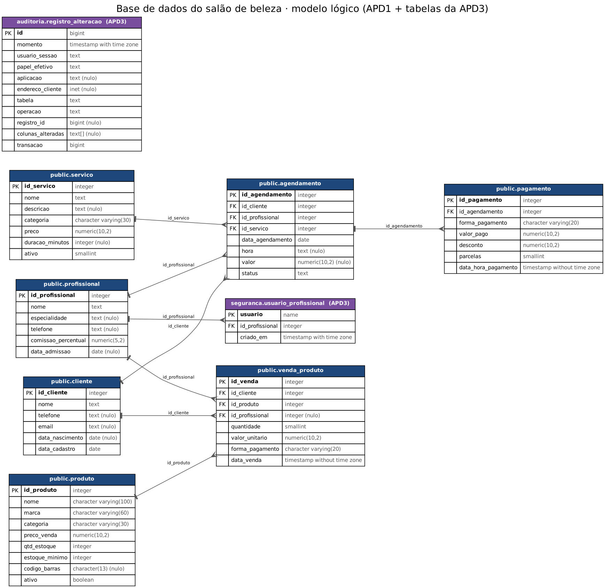

# Modelo da base de dados

| Arquivo | Conteúdo |
|---|---|
| `modelo_logico.png`, `modelo_logico.svg` | Modelo lógico: as 7 tabelas da APD1 (azul) e as 2 tabelas criadas na APD3 (roxo), com tipos, chaves primárias (PK), estrangeiras (FK) e colunas que aceitam nulo |
| `modelo_logico.dot` | Fonte Graphviz do diagrama, gerada do catálogo do banco por [`../apd3/fonte/gerar_modelo.py`](../apd3/fonte/gerar_modelo.py) |

O modelo físico (DDL completo, com restrições, índice, rotinas e gatilhos)
está em [`../apd3/ambiente-local/estrutura_apd1.sql`](../apd3/ambiente-local/estrutura_apd1.sql).

Tabelas criadas na APD3, fora do schema `public`:

- `seguranca.usuario_profissional`: liga cada usuário do banco a um
  profissional do salão; é a base do RLS da agenda.
- `auditoria.registro_alteracao`: trilha de auditoria (quem, quando, de onde e
  quais colunas mudaram, sem os valores).

Além delas, a APD3 criou views nos schemas `relatorios` (5 views agregadas) e
`agenda` (`vw_minha_agenda`), descritas em
[`../apd3/politicas-administracao-seguranca-integridade.md`](../apd3/politicas-administracao-seguranca-integridade.md).
